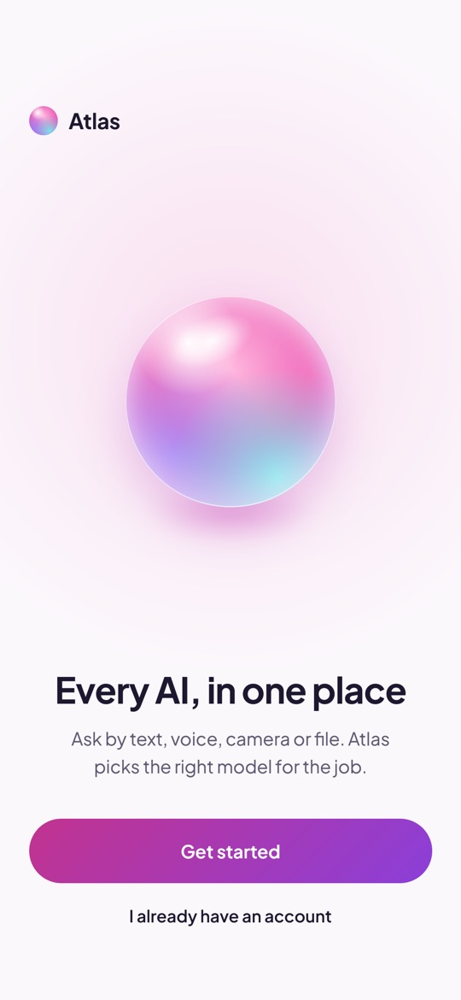
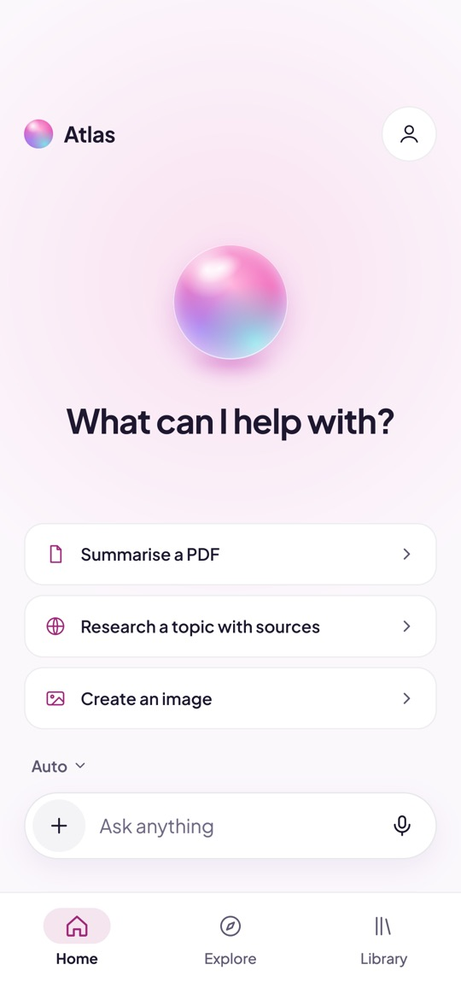
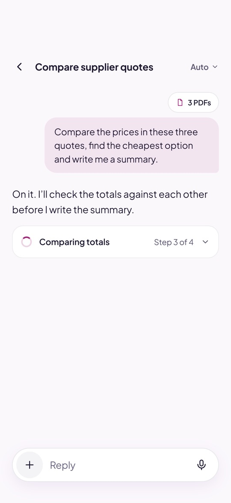
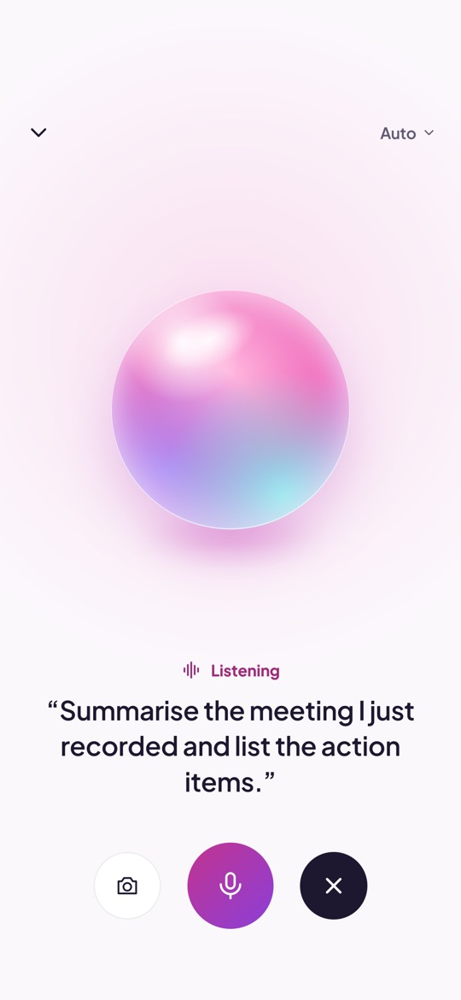

# Atlas

An AI assistant reproduced from a design of ten pages and made to work end to end.

{{shots}}




{{/shots}}

## What it shows

- **Soft light**: radial gradients, a blurred background, inner shadows.
- **A bottom sheet** over a screen, and a row of chips that scrolls sideways.
- **A chat that is real**: with its server, answers come from a language model, chats are kept and listed, and the chosen model and plan are saved.
- **An app that works without its server**: when the server does not answer, it is the scripted app of the design.
- **A server address chosen at build time**, so a deployed address never enters the repository.

## The screens

Onboarding, sign in, home, chat, the model picker, live voice, explore, plans, and simplified versions of home and chat.

## Run it

```sh
cargo test -p atlas
cargo run -p atlas --example screenshot -- out/ 04 --diff --phone
tools/preview.sh atlas
MORNINGSTAR_APP=atlas MORNINGSTAR_ABIS=arm64-v8a tools/build-android.sh --install
```

With its server:

```sh
cd examples/atlas/server
cp .env.example .env        # then fill in the keys; .env is never committed
npm start                   # 127.0.0.1:8788
adb reverse tcp:8788 tcp:8788
```

The server needs a PostgreSQL database and a DeepSeek key; an ElevenLabs key is optional and gives live voice. Node 22 or newer.

Atlas declares no opt-in service, so its APK carries no LiveKit code: about 10 MB. `examples/atlas/SCREENS.md` is the full description.
