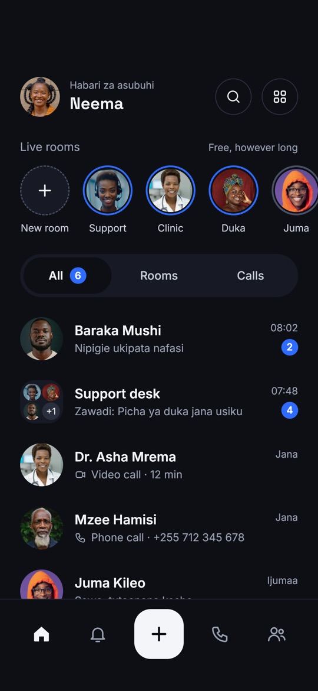
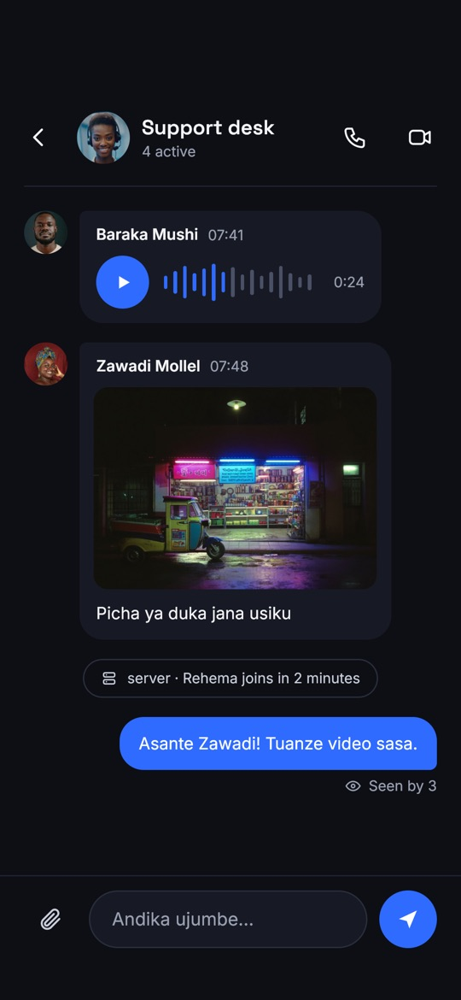
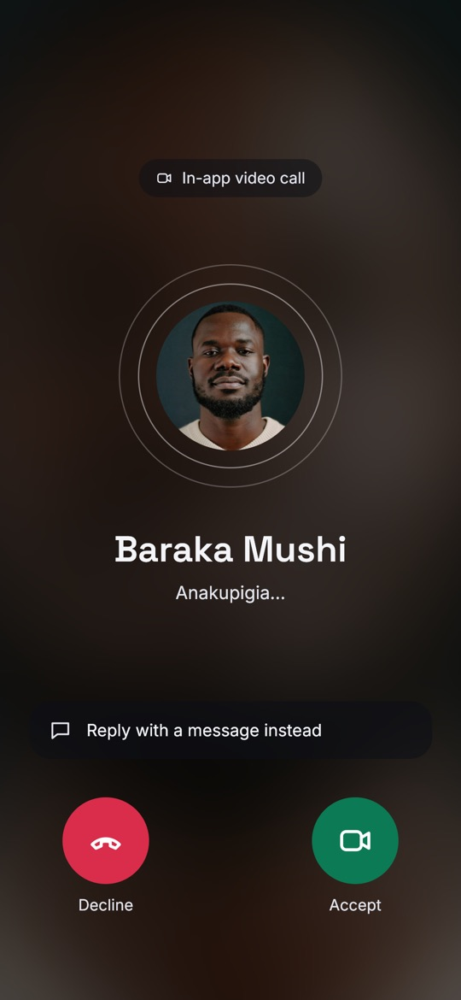
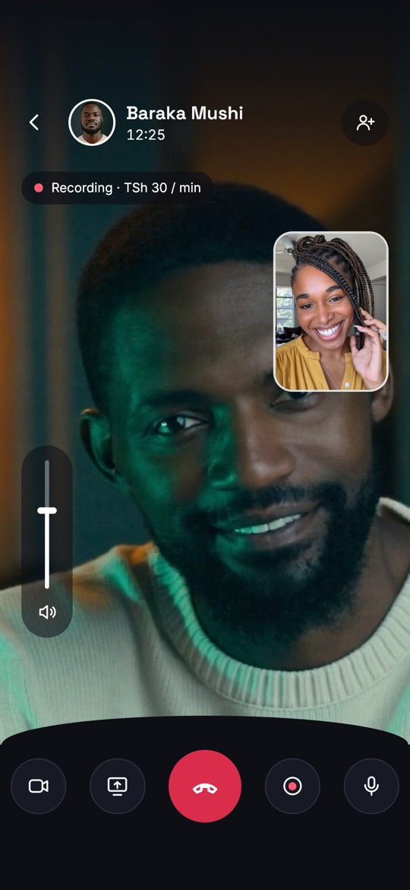

# Barua Talk

Rooms, chat and calls, reproduced from a design of five pages and made to work with a server. It is the app that uses live rooms: sound, both cameras and a shared screen.

{{shots}}




{{/shots}}

## What it shows

- **Photographs beside the drawing**, a blurred backdrop behind an incoming call, and an arched bar.
- **A live room**: an answered call, a joined room and a dialled phone call join with the ticket the server gives. Mute, the loudspeaker, the camera and screen sharing act on the real connection.
- **Honest status**: the call screen says in words how the sound stands, including why there is none.
- **Chat**: in rooms, and between two people.
- **All four opt-in services**: `live`, `live-video`, `live-screen` and `live-background`.
- **A browser test client**: the server serves a page at `/console` that speaks the same contract as the app, so a call can be made between a browser tab and a phone.

Beyond the five designed screens it has its own: a welcome screen, a dial pad, a new-room screen, people, notifications, and a screen about the server.

## Fidelity

Each designed screen is held to its picture:

| Screen | Measured difference | Limit |
| --- | --- | --- |
| Home | 0.0847% | 0.10% |
| Room | 0.6900% | 0.70% |
| Incoming call | 0.0154% | 0.05% |
| Video call | 0.2860% | 0.30% |
| Phone call | 0.0499% | 0.05% |

## Run it

```sh
cargo test -p barua-talk
cargo run -p barua-talk --example screenshot -- out/ 04 --diff --phone
tools/preview.sh barua-talk
MORNINGSTAR_APP=barua-talk MORNINGSTAR_ABIS=arm64-v8a tools/build-android.sh --install
```

With its server:

```sh
cd examples/barua-talk/server
cp .env.example .env        # then fill in the keys; .env is never committed
npm start                   # 127.0.0.1:8789, and the test client at /console
adb reverse tcp:8789 tcp:8789
```

The server needs a PostgreSQL database and a Barua Talk API key. Phone calls cost money upstream and stay off unless the server is told otherwise. Node 22 or newer. `server/API.md` is the contract between the app and the server.

## What has been verified

The app passes its tests on the development machine, and its server's tests pass against the real Barua Talk API for rooms, tickets, chat and in-app calls. The app has been installed on a phone. **No call has been confirmed working on a phone yet**: sound and pictures through a real room are unverified, and the live preview on a Mac answers live rooms with `Unsupported`.

`examples/barua-talk/SCREENS.md` has the step-by-step test for a phone, with the log line that proves each step.
