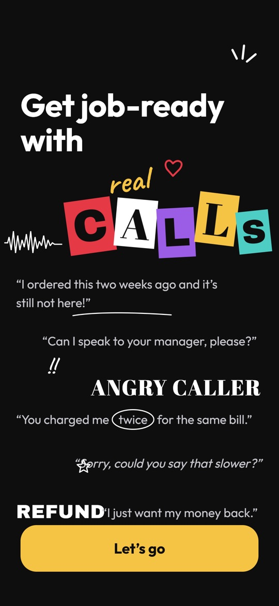
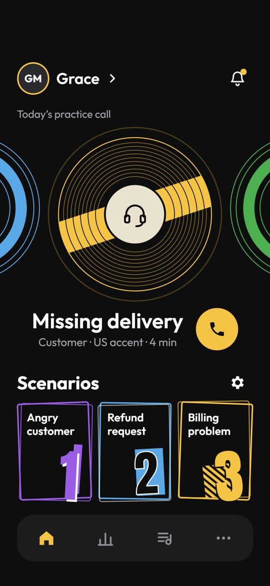
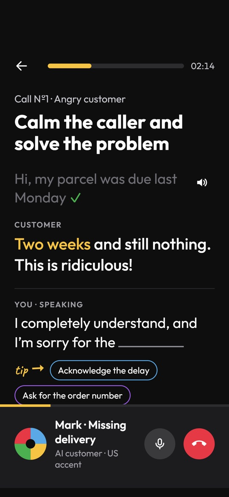
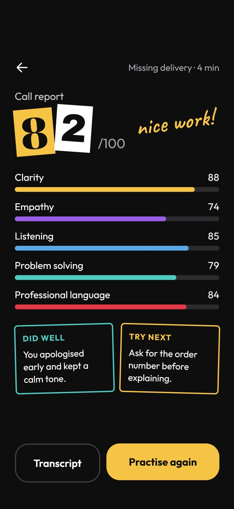

# CallReady

Practice for call-centre work: the app plays an angry customer and scores how the call was handled. Five screens are reproduced from a heavily illustrated design, and more are the app's own, added so that every control leads somewhere.

{{shots}}




{{/shots}}

## What it shows

- **Turned elements**: tiles and text drawn through a transform, with text that stays sharp.
- **Multi-colour vector pictures** and illustrations loaded from SVG files.
- **Text effects**: hard shadows, outlined digits, italic, numbers that line up.
- **A launcher icon of its own**, drawn from the app's art by `cargo run -p callready --example icon`.
- **Recording and playback** through effects, with a server that plays the caller.

## Run it

```sh
cargo test -p callready
cargo run -p callready --example screenshot -- out/ --diff
tools/preview.sh callready
```

Without its server it is a scripted app. With it, the call is real:

```sh
cd examples/callready/server
cp .env.example .env        # then fill in the keys; .env is never committed
npm start                   # 127.0.0.1:8787
```

The server needs a PostgreSQL database and a DeepSeek key, and optionally an ElevenLabs key for voice; without the voice key calls run in text. Node 22 or newer.

`examples/callready/SCREENS.md` lists every screen and control.
