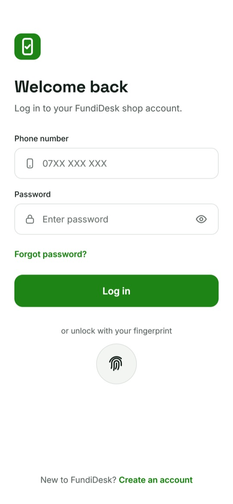
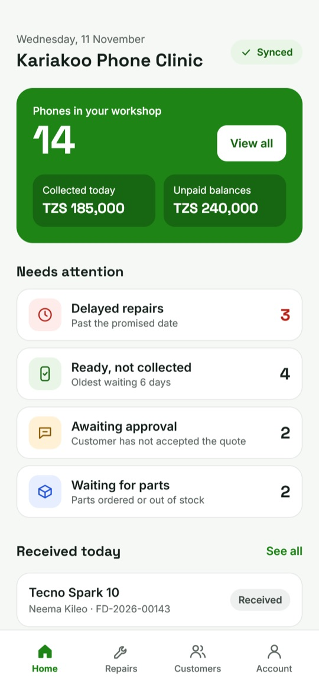
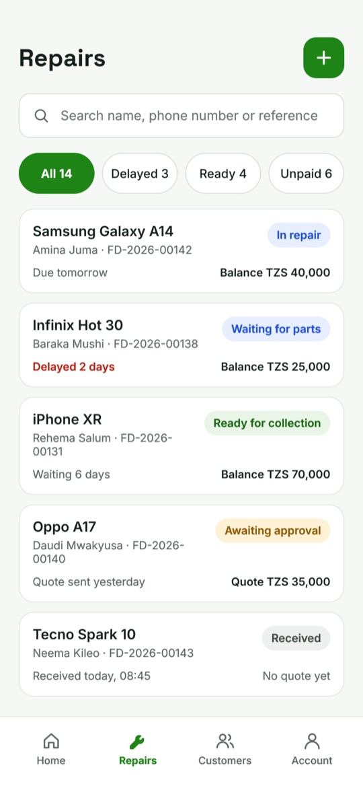
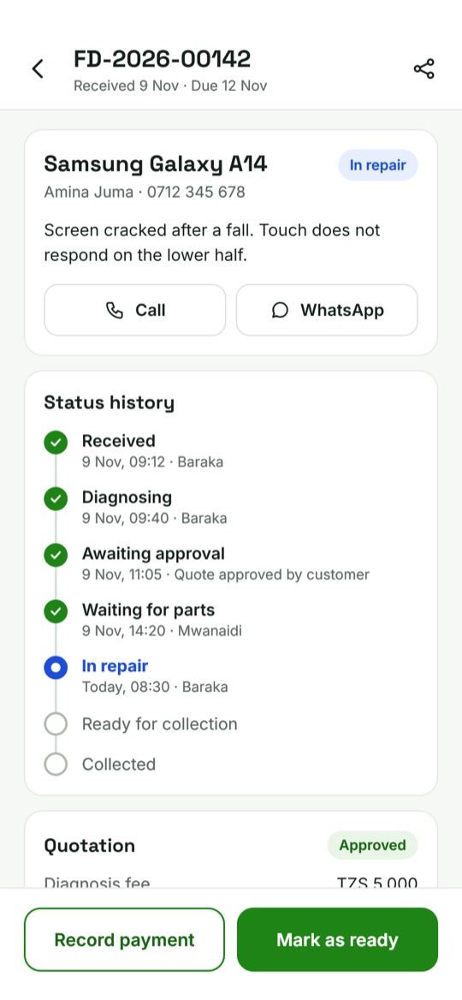

# FundiDesk

A repair shop's app: twelve screens reproduced from a real design, each tested against the design's own picture. It is **the model to imitate** when building from a design.

{{shots}}




{{/shots}}

## What it shows

- **The loop from a picture to code.** Render, compare with `morningstar-diff`, read the report, change one thing, repeat.
- **A design's tokens in one place**: `src/theme.rs` holds every colour, `src/icons.rs` every icon, `src/components.rs` every piece that occurs more than once.
- **One file per screen**, so screens can be built in parallel.
- **Real forms**: its text fields are working inputs.
- **A limit per screen** in `tests/fidelity.rs`: the largest share of pixels that may differ from the design, set from what was measured.

## The screens

Splash, onboarding, log in, create account, verification, shop setup, dashboard, repairs list, new repair, repair details, record payment and tracking.

## Run it

```sh
cargo test -p fundidesk
cargo run -p fundidesk --example screenshot -- out/ 07 --diff --phone   # one screen against its design
tools/preview.sh fundidesk
MORNINGSTAR_APP=fundidesk MORNINGSTAR_ABIS=arm64-v8a tools/build-android.sh --install
```

Start with `examples/fundidesk/SCREENS.md` in the repository: it is the method, written for whoever builds the next screen.

## What has been verified

It launched on a Galaxy A27 (first frame drawn, then idle, from the log). Typing into its fields was verified there with the system keyboard.
