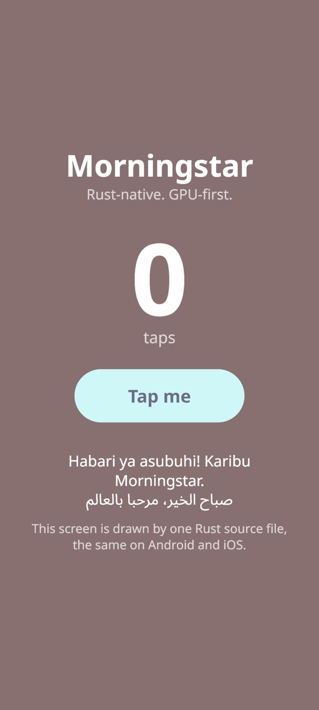
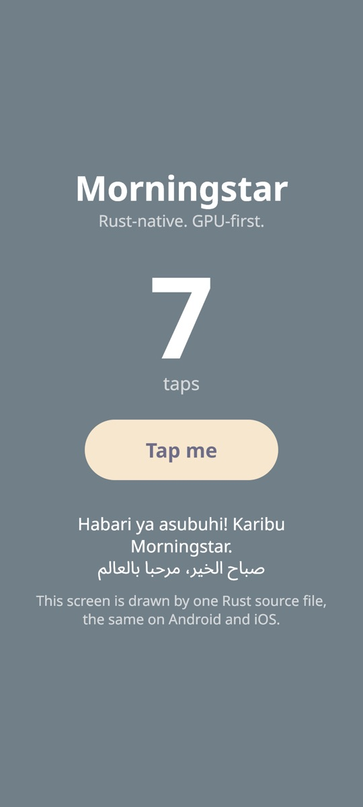

# hello-gpu

The low-level example. It does not use the UI layer: it implements the runtime's `App` trait directly, paints its own display list and does its own hit-testing. Read it to see what is underneath, not as a way to write an app.

{{shots}}


{{/shots}}

## What it shows

- The engine's contract with an app: lifecycle in, a display list out.
- Drawing operations by hand: rectangles, text, the safe area.
- Text in three scripts on one screen, including Arabic.
- It is the default app of `tools/build-android.sh`, and was the first thing drawn on a phone.

## Run it

```sh
cargo run -p hello-gpu --example screenshot out/
tools/build-android.sh --install
cargo ndk -t arm64-v8a clippy -p hello-gpu
```
