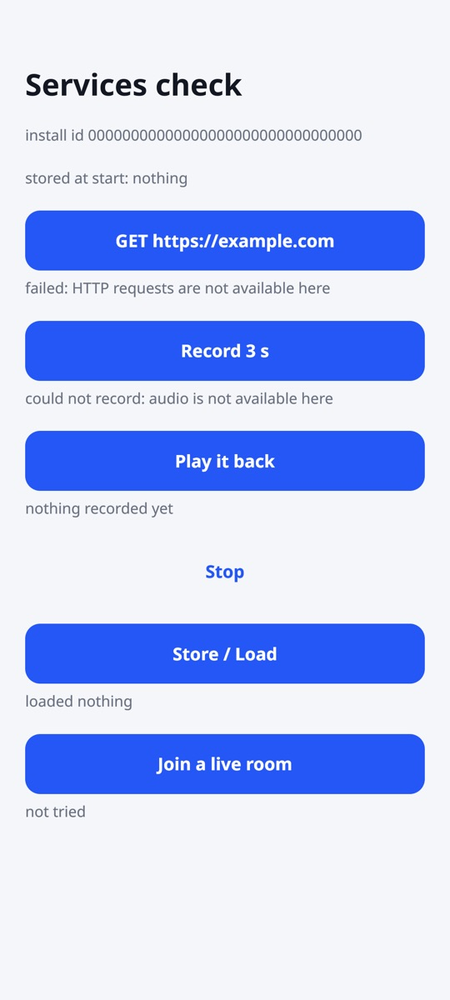

# services-check

A smoke test for a phone: one screen with one button per platform service. It is also the smallest app that uses effects, with scripted tests for each.

{{shots}}

{{/shots}}

## What it shows

- An HTTP request, a recording, playing it back, a stored value, and joining a live room, each started by a button and each reporting its result as a line of text.
- How every effect is tested: the test reads the request and answers in the host's place.
- The `live` service alone: it is the voice-only build, about 30 MB as an APK.

## Run it

```sh
cargo test -p services-check
MORNINGSTAR_APP=services-check MORNINGSTAR_ABIS=arm64-v8a tools/build-android.sh --install
```

On the phone, press each button and read the line under it; `adb logcat -s Morningstar` shows what the host did. Rendered on the development machine, as in the picture, every service answers that it is not available: nothing there can carry one out.
