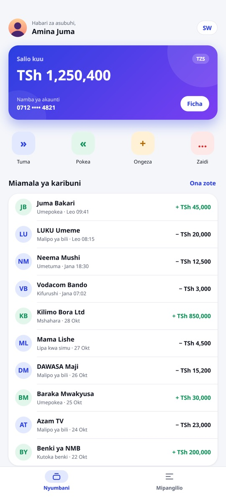
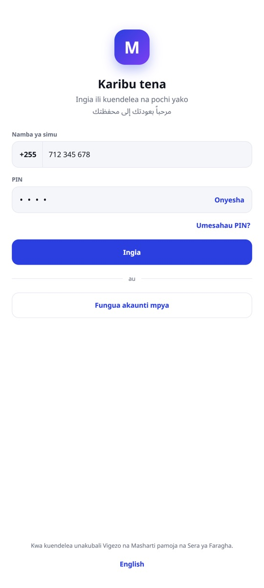
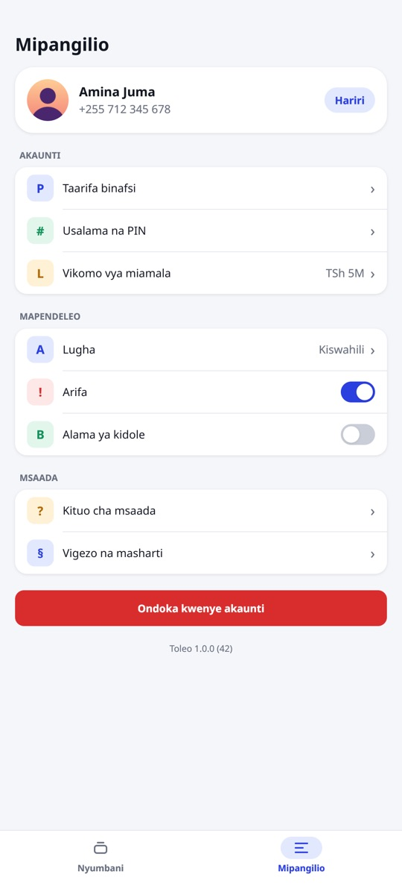

# Showcase

Three realistic screens written with the UI layer and nothing else: no design file, no server. It is the smallest example of an app with several screens, a form and a settings list, and the one `docs/building-screens.md` tells you to imitate first.

{{shots}}



{{/shots}}

## What it shows

- Cards, a gradient, avatars and a scrolling list on one screen.
- A form with text inputs, focus and validation.
- A settings list with toggles drawn from boxes.
- The same screens in Swahili and English, including a line of Arabic shaped right to left.
- Visual-regression tests: each screen is compared with a reference picture.

## Run it

```sh
cargo test -p showcase
cargo run -p showcase --example screenshot out/ 3     # the screens at 3 px per dp
tools/preview.sh showcase
MORNINGSTAR_APP=showcase tools/build-android.sh --install
```

## What has been verified

Its home screen on a Galaxy A27 matched the desktop render by eye: the first check of the full shader on Vulkan.
