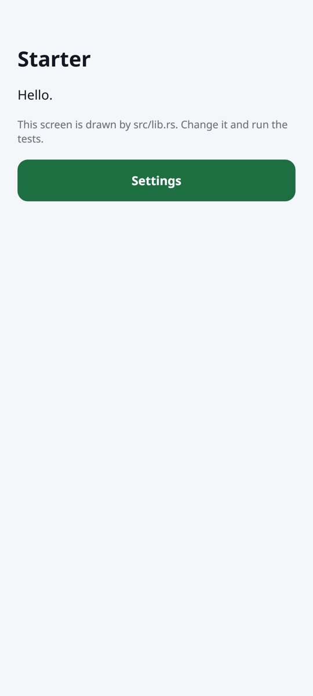
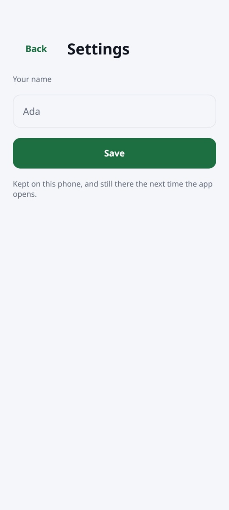

# Starter

The app `morningstar-new` writes. It is not kept in the repository: it is generated, so it cannot drift from the generator. These pictures are of one generated for this page.

{{shots}}


{{/shots}}

## What it shows

- Two screens on a `Navigator`, with a transition between them and the system's Back.
- A text input in a framed box, with a label for screen readers.
- A value kept on the phone with `store` and read back at `setup`.
- A theme with one brand colour.
- Tests that pass from the first minute: a journey, an accessibility check, and a picture of each screen.

With `--server` it also has an "Ask the server" button, an HTTP request with a timeout, and a dependency-free Node server with its own tests.

## Make one

```sh
cargo run -q -p morningstar-devtools --bin morningstar-new -- my-app --name "My App"
cargo test -p my-app
tools/preview.sh my-app
```

[Your first app](../getting-started.md) continues from here.

## What has been verified

A generated app builds, passes its 11 tests, and builds into an Android APK of about 10 MB. No generated app has been run on a phone yet.
