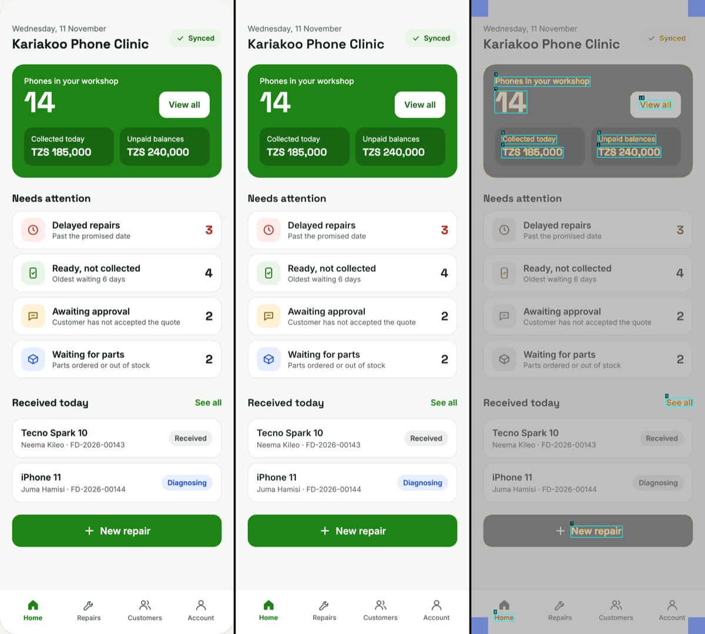
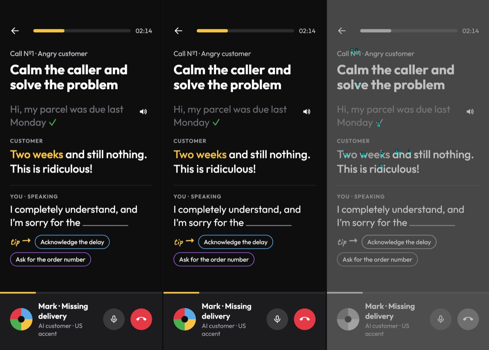
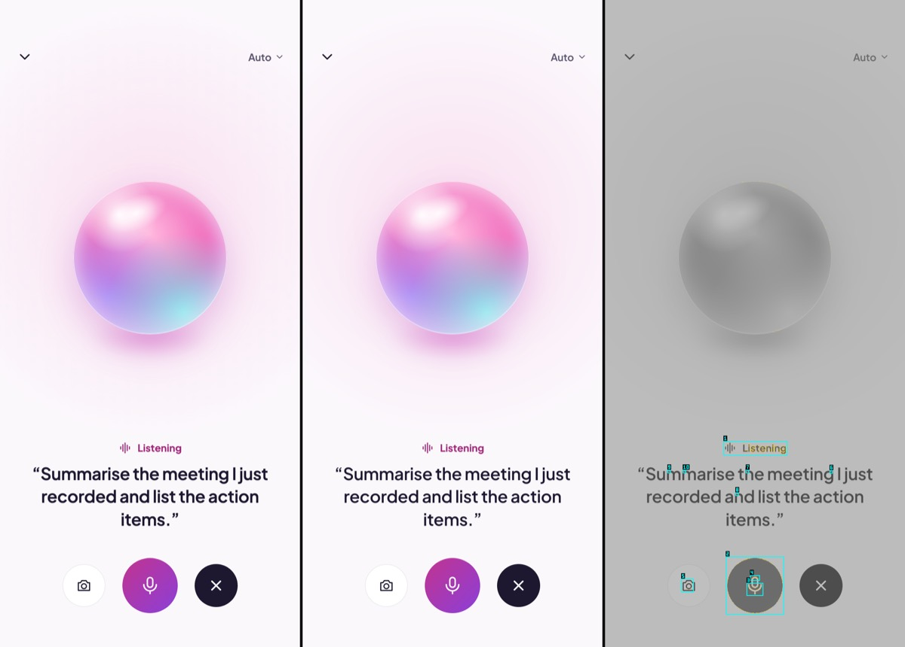
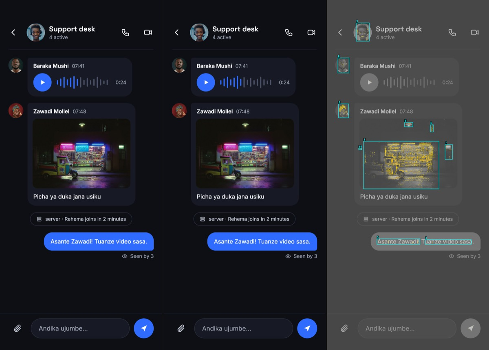

# Designs, checked

Morningstar draws every pixel itself, and every designed screen is tested against its design's picture. When a design needs something the framework can't draw yet, you add it to the framework: the renderer is small, every decision in it is recorded in an [architecture decision](../architecture/README.md), and its pixel tests tell you, or your AI agent, when it's right.

This page shows the evidence: four designs made by others, 32 screens, each compared with the design.

## Design, render, difference

Each picture shows, left to right, the design as Chrome draws its HTML, the app's frame from Morningstar's renderer, then a heat map of where the two differ, with the worst regions boxed. Each app's screenshot program (`--diff`) writes these on a Mac, with no phone.

**FundiDesk**, a phone-repair shop, twelve screens. The dashboard: summary cards, two lists and a tab bar. 0.361% of its pixels differ, almost all of it in text, which Morningstar rasterises a little differently from Chrome. The light-on-green figures show it most.

**CallReady**, call-centre practice, five illustrated screens with turned elements, multi-colour vector pictures and text effects. The live call: 0.006%.

**Atlas**, an AI assistant, ten screens with radial gradients, blur and inner shadows. The voice screen: 0.051%.

**Barua Talk**, rooms, chat and calls, five screens with photographs beside the drawing. A room's chat is the worst of all 32 screens, at 0.690%. Most of that is the photograph of the shop, which Morningstar scales a little differently from Chrome.

## Every screen

{{include docs/reference/fidelity.txt}}

**Differ** is the share of pixels whose colour differs visibly: by more than 2 on a scale where 0 is identical and 100 is black against white, after allowing one pixel of anti-aliasing at edges. **Mean error** is the average difference over all pixels on that scale.

The limits in each app's `tests/fidelity.rs` are these measured numbers, not targets someone chose. A change that makes any screen look less like its design fails the tests. Each app's `SCREENS.md` says what the remaining difference consists of.

## Do it yourself

The same loop works for your own design: render, compare, fix the worst region, render again. [Design to code](../design-to-code.md) walks through it, and [Building screens](../building-screens.md) covers writing the screen.

To produce this page again: `tools/docs-screenshots.sh fidelity`, then `python3 tools/build-docs.py`.

What this does not show: a frame on a Mac is not a phone. How the screens behave on a device is tracked in [Platform status](../reference/platform-status.md).
