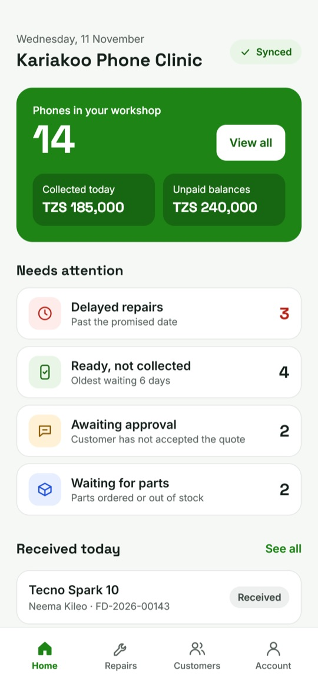
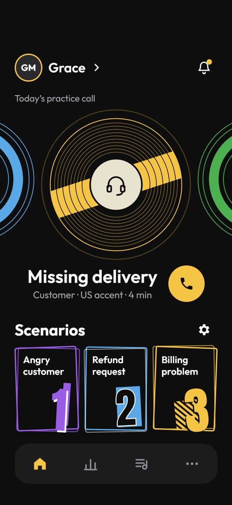
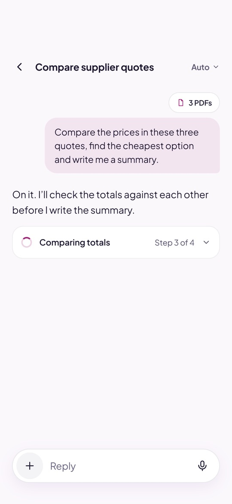
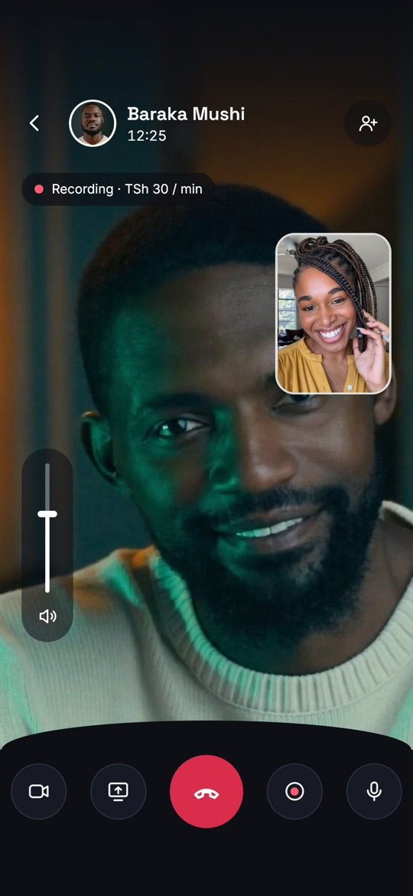

# Morningstar documentation

Morningstar is a Rust framework for building Android and iOS apps from one codebase. You describe each screen as a function of your app's state; Morningstar lays it out and draws it itself on the GPU. There is no web view, and none of the platform's own widgets.

{{snippet examples/docs-snippets/src/counter.rs#app title="src/lib.rs"}}

That is a whole application. `view` says what the screen looks like for the current state, a tap delivers a `Message`, and `update` is the only place the state changes. One more line makes the crate an app the phone can start:

{{snippet examples/docs-snippets/src/counter.rs#register}}

## Start here

New to the framework? These four pages take you from an empty folder to an app running on your phone.

{{cards}}
- [Installation](guide/installation.md): What a machine needs to build an app, test it and put it on an Android phone.
- [Your first app](getting-started.md): One command writes an app that builds and passes its tests. Then change it.
- [The application model](guide/application-model.md): State, messages, `view`, `update`, and how work that takes time comes back as a message.
- [Widget gallery](widgets/index.md): Every widget with its methods, read from the source, and a sample that compiles.
{{/cards}}

## What apps built with it look like

Every picture in these pages is one frame through the real renderer, produced with no phone by the app's own screenshot program. Four of the example apps follow a design made by others, and each is held to its design's pictures by tests: on the median screen 0.087% of pixels differ visibly from the design, and on the worst 0.690%. [Designs, checked](guide/fidelity.md) shows every design, render and difference side by side.

{{shots}}

{{/shots}}

The [examples](examples/index.md) say what each app shows and how to run it.

> **Where the project stands.** Android works: apps have been installed and used on one phone. The iOS host is written but has never been compiled, and several services answer "unsupported" there. [Platform status](reference/platform-status.md) lists what has been seen on a device and what has not.

## Supported platforms

| Platform | State |
| --- | --- |
| Android | Builds for API 24 (Android 7.0) and later. Run on one phone so far: a Galaxy A27 on Android 16 |
| iOS | Shared code type-checks for iOS; the Swift host has never been built or run |
| Development machine | A Mac: the tests draw on its GPU, and the [live preview](reference/tools.md#the-live-preview) opens a window on it |
| Rust | Stable, 1.87 or newer |

## Getting help

The repository is the reference. `AGENTS.md` at its root holds the rules every change follows, each subsystem's decision is recorded under [decision records](architecture/README.md), and [troubleshooting](reference/troubleshooting.md) collects the problems that have actually come up.
